I'm studying computer science (AI/ML) at Atlas SkillTech University in Mumbai and graduate in 2028. I build full-stack web apps, and my internships so far have covered scraping, LLM tooling and machine learning. I'm open to work.

[Portfolio](https://krrishkothari-portfolio.netlify.app) | [Resume](https://krrishkothari-portfolio.netlify.app/Krrish_Kothari_Resume.pdf) | [LinkedIn](https://www.linkedin.com/in/krrishkothari01) | [Email](mailto:krrishbkothari@gmail.com)

## Projects

### [DevgnCineX pricing dashboard](https://github.com/Krrishkothari/DevgnCineX-Location-Wise-Pricing-Dashboard)

Built during my internship at Devgn Cinex. It compares Devgn Cinex ticket prices with nearby competitors by scraping BookMyShow every hour. It tracks 42 cinemas in 17 locations (17 Devgn Cinex screens and 25 competitors) and collects prices for today and the next 3 days.

A few details from the code:

- Locations run 3 at a time. Any that fail or come back empty get a second pass, one at a time, so the retry doesn't hit the same contention that caused the failure.
- Writes are batched every 15 seconds, because a single run saves hundreds of times and each save would otherwise re-serialise the whole dataset.
- Price history stores changes only, capped at 100 points per row, and rows with show dates older than 30 days are dropped.

Stack: React, Vite, Tailwind CSS, Node.js, Express, Playwright, Docker

### [TxnScreen](https://github.com/Krrishkothari/Fraud-and-Duplicate-Transaction-Screener) (in progress)

A tool I'm building with Hardik and Vedant that screens CSV transaction files for duplicates and suspicious activity. It's early. So far I've set up the Spring Boot backend and written the transaction model, API error handling and money parsing, which converts rupee amounts to whole paise so there's no floating-point rounding.

Stack: Java, Spring Boot, React, TypeScript

### [Driver Sleep Detection](https://github.com/Krrishkothari/Driver-sleep-detection)

A team project with Vedant Poman. A webcam and MediaPipe face landmarks track how long the driver's eyes stay closed. At 3 seconds an Arduino cuts the motor relay and sounds a buzzer, and at 5 seconds an ESP32 sends a Telegram alert.

Stack: Python, OpenCV, MediaPipe, Arduino, ESP32

### Code not public

- **Agro AI:** crop disease diagnosis, farming advice from the Gemini API, and voice updates. Next.js, Flask, MongoDB, LangChain, Twilio.
- **Synq POS:** restaurant point of sale with offline-first sync and floor management. React, FastAPI, PostgreSQL.
- **BalanceBuddy:** expense splitting with real-time in-app chat. JavaScript, Firebase.

## Experience

**AI Intern, Devgn Cinex** (May to Aug 2026, on-site)\
Built the pricing dashboard above, helped restructure the company website, and worked on AI-based workflow automation.

**Software Development Intern, Sypha AI** (Nov 2025 to Jan 2026, virtual)\
Worked on a VS Code extension, covering features, testing and optimization. Also compared LLM quantization methods (FP16, INT8, INT4, GPTQ, AWQ) on accuracy, latency, memory and infrastructure cost.

**Machine Learning Intern, Cognifyz Technologies** (Apr to May 2025, virtual)\
Built rating prediction, cuisine classification and a content-based recommender on restaurant data.

## Outside coursework

- Finalist, ODOO x ADANI 24-hour hackathon, Adani University, Ahmedabad (Jan 2026)
- Co-Head, Esports Department, SPARC Society (since Aug 2025)
- Secretary, Finance Department, Rotaract Club (Aug 2024 to May 2025)

